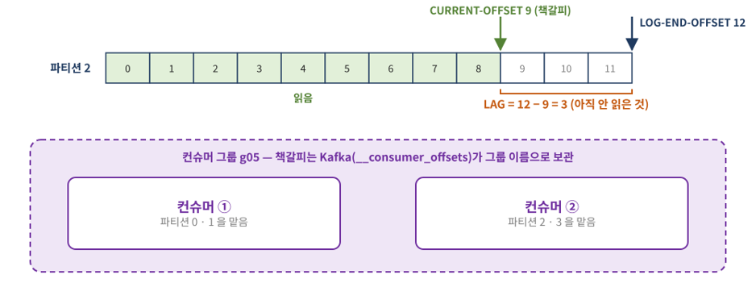

## 읽어도 사라지지 않는 로그

Spark 수업에서는 파일을 읽어 표로 만들었다. Kafka 수업은 그 앞단에서 데이터가 어떻게 전달되고, 여러 프로그램이 어디까지 읽었는지 어떻게 관리하는지를 다룬다. 첫 파트는 STEP 02~05의 Docker 실행, 콘솔 송수신, 파티션과 컨슈머 그룹이다.

네 편은 `kafkacamp` 자료를 **11월 9~12일 복습 정리**로 재구성했다. 압축파일에는 10월 26~27일 수정 기록과 10월 날짜의 출력 예시가 있다. 게시 날짜는 실제 수업일이 아닌 복습 정리 날짜다.

## 1. 실습 데이터와 실행 환경

교통카드 로그는 `make_data.py`로 생성하는 합성 데이터다. 한 행은 승차 또는 하차 이벤트이며, 하나의 이동에는 같은 `trip_id`를 가진 두 종류의 태그가 있을 수 있다.

| 자료 | 역할 | 첨부 원문 기준 |
| --- | --- | ---: |
| `data/stations.csv` | 역 코드·이름·노선·자치구 기준표 | 8행 |
| `data/tags_mini.jsonl` | 작은 송수신 예제 | 12행, 고유 이벤트 11개 |
| `data/tags_day.jsonl` | 하루 이벤트 | 2,008행, 고유 이벤트 1,988개 |
| `data/stream_src/part_*.jsonl` | 단계별 재생 입력 | 10개 파일 |

중복 이벤트를 일부러 넣었기 때문에 ‘Kafka에 들어간 레코드 수’와 ‘고유 이벤트 수’가 같지 않다. 표의 건수는 첨부 데이터 파일을 집계한 값이다.

실습 경로는 `C:\kafkacamp`, Docker 이미지는 `apache/kafka:4.3.1`이다. requirements에는 `confluent-kafka==2.16.0`, `pyspark==4.1.3`, `delta-spark==4.4.1`, `pandas==2.3.3`, `pyarrow==26.0.0`, `ipykernel==7.4.0`이 지정돼 있다.

## 2. 어느 터미널에서 실행하는가

먼저 Docker Desktop이 실행된 Windows PowerShell에서 작업 폴더를 연다.

```powershell
cd C:\kafkacamp
docker compose -f kafka1.yml up -d
docker ps
docker logs kafka | Select-String "Kafka Server started"
```

`up -d`는 Compose 설정에 맞는 컨테이너를 생성·시작하고 백그라운드에서 실행한다. 이미 만든 컨테이너를 잠깐 멈출 때는 `stop`, 다시 시작할 때는 `start`를 사용한다.

```powershell
docker compose -f kafka1.yml stop
docker compose -f kafka1.yml start
```

제공된 설정은 데이터 폴더만 읽기 전용으로 마운트하고 Kafka 로그 디렉터리에 별도 영속 볼륨을 지정하지 않는다. 따라서 컨테이너를 제거·재생성하면 그 안에 남긴 로그의 보존을 기대하면 안 된다. `down`은 일상적인 일시 정지 명령과 구분한다.

| 접근 위치 | 자료의 주소 |
| --- | --- |
| Windows Python·Spark | `localhost:9092` |
| 단일 브로커 컨테이너 내부용 listener | `kafka:19092` |
| KRaft controller listener | `29093` |

`listeners`는 브로커가 연결을 받는 주소, `advertised.listeners`는 클라이언트에 알려 주는 후속 접속 주소다. 다른 컨테이너에서 `localhost`는 자기 자신을 가리킨다. 주소가 맞는지 확인할 때 포트 공개 설정과 알려 주는 주소를 함께 본다.

이 설정은 broker와 controller 역할을 함께 수행하는 KRaft 구성이다. 이 실습에는 ZooKeeper를 별도로 띄우지 않는다.

## 3. 토픽을 만들고 메시지 보내기

PowerShell에서 컨테이너 셸로 들어간다. 그 뒤의 `./kafka-*.sh` 명령은 **컨테이너 Bash**에서 실행한다.

```powershell
docker exec -it kafka bash
```

단일 브로커 자료의 콘솔 실습은 컨테이너 내부에서도 `localhost:9092` listener를 사용한다.

```bash
./kafka-topics.sh --version
./kafka-topics.sh --bootstrap-server localhost:9092 --create --topic hello
./kafka-topics.sh --bootstrap-server localhost:9092 --describe --topic hello
./kafka-console-producer.sh --bootstrap-server localhost:9092 --topic hello
```

프로듀서가 입력을 기다리면 `hello kafka`처럼 한 줄을 입력하고 Enter로 보낸다. 종료는 Ctrl+C다. 다른 터미널에서도 컨테이너로 들어가 읽는다.

```bash
./kafka-console-consumer.sh --bootstrap-server localhost:9092 --topic hello --from-beginning --max-messages 3
```

읽는다고 Kafka의 메시지가 삭제되는 것은 아니다. 보관 기간·크기 정책이나 compaction 같은 로그 관리 정책은 소비자의 읽기와 별개다. 레코드 한 줄을 일반 DB의 UPDATE처럼 고쳐 쓰는 방식도 아니다.

`--max-messages 3`은 최대 세 개를 읽는 종료 조건이다. 토픽에 메시지가 부족하면 더 들어오기를 기다릴 수 있다. 콘솔 컨슈머의 입력창에 문자를 치는 것은 프로듀서로 전송하는 동작이 아니다.

작은 JSONL 파일도 한 줄씩 메시지로 보낼 수 있다. 아래 `<`는 PowerShell이 아닌 컨테이너 Bash의 리다이렉션이다.

```bash
./kafka-console-producer.sh --bootstrap-server localhost:9092 --topic hello < /data/tags_mini.jsonl
```

자료의 `hello:0:16` 예시는 새 토픽에 텍스트 4개와 파일 12행을 정확히 한 번씩 보낸 순서에서 나온다. 기존 데이터가 있거나 셀을 다시 실행하면 값이 달라진다.

## 4. 파티션·키·오프셋

```bash
./kafka-topics.sh --bootstrap-server localhost:9092 --create --topic tags3 --partitions 3
./kafka-console-producer.sh --bootstrap-server localhost:9092 --topic tags3 --reader-property parse.key=true --reader-property key.separator=:
```

입력 예시는 `C001:IN S01`, `C002:IN S06`, `C001:OUT S03`이다. 콜론 앞은 key, 뒤는 value다. 컨슈머에서 파티션과 오프셋도 함께 본다.

```bash
./kafka-console-consumer.sh --bootstrap-server localhost:9092 --topic tags3 --from-beginning --formatter-property print.partition=true --formatter-property print.offset=true --formatter-property print.key=true
```

- **토픽:** 메시지 흐름을 나누는 이름.
- **파티션:** 토픽 안에서 순서가 있는 로그 조각.
- **오프셋:** 해당 파티션 안의 레코드 위치.
- **키:** 기본 키 기반 분배에서 같은 파티션으로 보낼 대상을 정하는 입력.

순서는 파티션 안에서 이해해야 한다. 여러 파티션 전체의 소비 순서를 하나의 시간순으로 보장하지 않는다. 같은 키가 같은 곳으로 가려면 파티셔너·키 직렬화·파티션 수 등 조건이 유지돼야 한다. 파티션을 늘리면 키의 배정이 바뀔 수 있고 기존 레코드가 자동 재배치되지는 않는다.

## 5. 컨슈머 그룹은 읽기 진행을 공유한다

```bash
./kafka-console-consumer.sh --bootstrap-server localhost:9092 --topic tags3 --group g05 --from-beginning --timeout-ms 5000
./kafka-consumer-groups.sh --bootstrap-server localhost:9092 --describe --group g05
```

일반 컨슈머 그룹에서는 한 파티션을 그룹 내 한 컨슈머가 맡는다. 같은 그룹에 컨슈머를 더하면 파티션을 나누어 읽고, 다른 그룹은 독립적으로 같은 로그를 읽는다. 컨슈머가 바뀌면 리밸런싱으로 담당이 재조정된다. 활성 컨슈머 수가 파티션 수보다 많으면 쉬는 컨슈머가 생길 수 있다.

<figure>
<a href="/images/lessons/kafka/group-offsets.png"></a>
<figcaption>컨슈머 그룹의 파티션 분담과 커밋 위치·로그 끝 위치의 관계</figcaption>
</figure>

`CURRENT-OFFSET`은 커밋한 다음 읽기 위치, `LOG-END-OFFSET`은 로그 끝 위치다. 자료의 예처럼 9와 12라면 lag는 3이다. 이는 미소비 진행 차이의 단서이지 최종 DB 저장 성공을 직접 보증하는 지표는 아니다.

`--from-beginning` 또는 `auto.offset.reset=earliest`는 유효한 커밋 오프셋을 무시하는 강제 초기화가 아니다. 재처리하려면 컨슈머를 멈추고 해당 실습 그룹의 reset 계획을 확인한다.

```bash
./kafka-consumer-groups.sh --bootstrap-server localhost:9092 --group g05 --topic tags3 --reset-offsets --to-earliest --dry-run
```

`--dry-run`은 변경 계획만 보여 준다. 컨슈머를 멈춘 상태에서 계획을 확인한 뒤 `--execute`로 바꾸면 그룹의 읽기 위치가 초기화되어 기존 메시지를 다시 처리하게 된다.

## 정리

Kafka에서 메시지를 읽는다는 것은 로그를 지우는 것이 아니라 읽기 위치를 이동하는 일이다. 다음 파트에서는 이 과정을 Python으로 옮기고 키 분배와 로그 재생을 확인한다.

작성 근거: `kafka1.yml`, STEP 02~05의 lab·answer, `reference/image4.png`, 첨부 데이터. 명령의 토픽명은 `tags3`로 통일했다.


## 함께 읽기

- [Kafka 수업 정리 ②: Python 송수신·키 분배와 이벤트 재생](/sk-encore-de-2/kafka/kafka-python-keys-replay/)
- [Kafka 수업 정리 ③: 복제·커밋 순서·멱등성으로 장애 이해하기](/sk-encore-de-2/kafka/kafka-replication-delivery/)
- [Kafka 수업 정리 ④: Spark 시간 창·Delta 파이프라인과 튜닝](/sk-encore-de-2/kafka/kafka-spark-delta-pipeline/)
