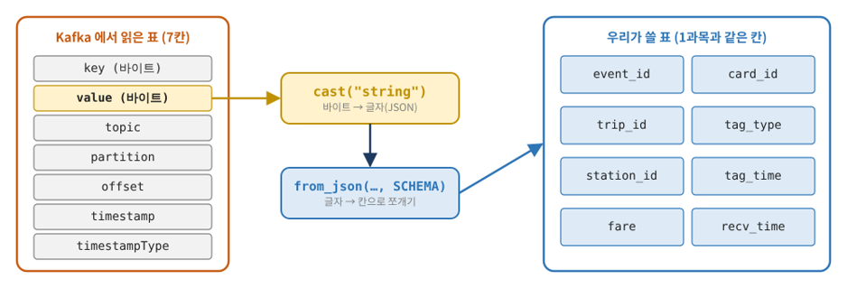
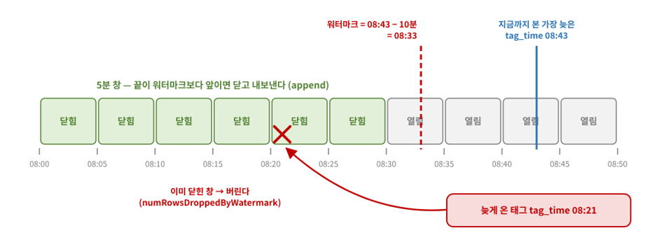

## Kafka의 로그를 Spark의 표와 연결하기

STEP 12~17과 종합 문제는 Kafka 읽기 → 시간 창 집계 → 결과 재전송 → Bronze·Silver·Gold → 튜닝으로 이어진다. 11월 12일은 이 범위를 묶은 복습 정리 날짜다.

앞 파트와 같은 합성 교통카드 로그를 사용한다. Kafka 레코드를 업무 이벤트로 해석한 뒤, 시간 창 집계와 이동 단위 테이블로 확장하는 흐름을 살펴본다.

## 1. Spark·Kafka·Delta 준비

`kafka1.yml`이 실행되고 `tags`는 3개 파티션에 하루 로그를 한 번 보낸 상태를 전제로 한다. Spark는 Windows 호스트에서 실행한다. 새 Interactive 세션에서 다음과 같이 시작할 수 있다. 이는 자료의 온라인 의존성 로딩 분기를 축약한 예다.

```python
import os
import sys
from pyspark.sql import SparkSession, functions as F
from delta import configure_spark_with_delta_pip
from delta.tables import DeltaTable

os.chdir(r"C:\kafkacamp")
os.environ["PYSPARK_PYTHON"] = sys.executable
BOOT = "localhost:9092"
KAFKA_PKG = "org.apache.spark:spark-sql-kafka-0-10_2.13:4.1.3"
builder = (SparkSession.builder.master("local[2]").appName("kafkacamp")
    .config("spark.sql.shuffle.partitions", "4")
    .config("spark.sql.extensions", "io.delta.sql.DeltaSparkSessionExtension")
    .config("spark.sql.catalog.spark_catalog", "org.apache.spark.sql.delta.catalog.DeltaCatalog"))
spark = configure_spark_with_delta_pip(builder, extra_packages=[KAFKA_PKG]).getOrCreate()
spark.conf.set("spark.sql.session.timeZone", "Asia/Seoul")
SCHEMA = """
event_id STRING, card_id STRING, trip_id STRING, tag_type STRING,
station_id STRING, tag_time TIMESTAMP, fare INT, recv_time TIMESTAMP
"""
```

PySpark와 Kafka connector는 자료의 4.1.3, Scala binary 버전은 2.13에 맞춘다. Kafka 브로커 버전과 Spark connector 버전은 서로 다른 구성요소의 버전이다.

원본은 `jars/*.jar`, 없으면 `ivy/jars/*.jar`를 읽고 둘 다 없으면 의존성을 내려받는다. 이미 실행 중인 Spark 세션이 있다면 세션을 새로 만들어 connector 설정을 적용한다.

## 2. Kafka 레코드와 업무 이벤트의 열 구분하기

```python
raw = (spark.read.format("kafka")
       .option("kafka.bootstrap.servers", BOOT)
       .option("subscribe", "tags")
       .option("startingOffsets", "earliest").load())
ev = (raw.select(
        F.from_json(F.col("value").cast("string"), SCHEMA).alias("e"),
        "topic", "partition", "offset")
      .select("e.*", "topic", "partition", "offset"))
ev.groupBy("tag_type").count().show()
```

Kafka의 key·value는 binary이므로 문자열로 바꾼 뒤 `from_json`으로 펼친다. `partition`·`offset`은 원천 위치, `event_id`·`trip_id`는 업무 식별자다. 같은 이벤트를 다시 발행하면 내용은 같아도 Kafka 위치는 달라진다.

<figure>
<a href="/images/lessons/kafka/kafka-to-dataframe.png"></a>
<figcaption>Kafka 레코드의 key·value를 DataFrame의 업무 열로 펼치는 과정</figcaption>
</figure>

단순 재생 한 번의 기준은 2,008행, IN 1,012행·OUT 996행, 고유 event_id 1,988개다. 이는 첨부 원문 집계이며 실제 토픽은 이전 재생 이력에 따라 달라질 수 있다. 배치 읽기에서 오프셋 범위는 파티션별 JSON으로 지정한다. 예를 들어 `.option("startingOffsets", '{"tags":{"0":0}}')`와 `.option("endingOffsets", '{"tags":{"0":10}}')`을 사용하면 `tags`의 0번 파티션에서 오프셋 0~9를 읽는다. 끝 오프셋 10은 포함하지 않는다.

## 3. 이벤트 시간 창과 워터마크

STEP 13은 `tags_live`에 조각을 순차 전송한다. 토픽과 체크포인트는 해당 실험만의 새 상태로 준비하며, 진행 중인 쿼리의 토픽을 임의로 재생성하지 않는다.

```python
live = (spark.readStream.format("kafka")
        .option("kafka.bootstrap.servers", BOOT)
        .option("subscribe", "tags_live")
        .option("startingOffsets", "earliest").load()
        .select(F.from_json(F.col("value").cast("string"), SCHEMA).alias("e"))
        .select("e.*"))
windowed = (live.withWatermark("tag_time", "10 minutes")
            .groupBy(F.window("tag_time", "5 minutes").alias("w"))
            .count())
q = (windowed.select(F.col("w.start").alias("start"),
                     F.col("w.end").alias("end"), "count")
     .writeStream.format("parquet")
     .option("path", "out/s13/win")
     .option("checkpointLocation", "chk/s13/win")
     .outputMode("append").trigger(availableNow=True).start())
q.awaitTermination()
```

5분은 집계 창 길이이고 10분은 이벤트 시간의 지연 허용 기준이다. ‘현재 시계에서 10분을 기다린다’가 아니다. 관측한 최대 이벤트 시간과 지연 기준으로 워터마크가 진행하며, 이전 배치에서 갱신한 워터마크가 다음 처리에 적용된다.

append는 확정된 창 결과를 내보낸다. 아직 닫히지 않은 끝부분 창은 출력되지 않을 수 있다. 기준보다 늦게 도착한 데이터는 상태 처리에서 제외될 수 있다. 따라서 배치 전체 건수와 스트리밍 append 결과 합계의 차이를 모두 누락 오류로 판단하지 말고, 시간 파싱 실패·늦은 이벤트·미확정 창을 구분한다.

<figure>
<a href="/images/lessons/kafka/event-time-watermark.png"></a>
<figcaption>5분 집계 창과 이벤트 시간 기준 워터마크의 관계</figcaption>
</figure>

자료는 `recentProgress`, `eventTime.watermark`, `numRowsDroppedByWatermark`를 함께 확인한다. `availableNow` 종료가 모든 창을 무조건 확정한다는 뜻은 아니다. 빈 입력 재실행에서는 진행 기록이 없을 수 있어 목록의 마지막 원소를 바로 꺼내는 진단 코드도 보완할 필요가 있다.

## 4. 계산 결과를 다시 Kafka에 쓰기

STEP 14는 역별 승차 집계를 `station_cnt`로 보내고, 5분 창 갱신 결과를 `win5`로 보낸다. 아래 boards는 `tags`를 event_id로 중복 제거한 뒤 IN을 역별로 센 결과다. 이 단계는 S99를 아직 포함하며 전체 정상화와는 다르다.

```python
boards = (ev.dropDuplicates(["event_id"]).filter(F.col("tag_type") == "IN")
          .groupBy("station_id").agg(F.count("*").alias("boards")))
out = boards.select(F.col("station_id").alias("key"),
                    F.to_json(F.struct("station_id", "boards")).alias("value"))
(out.write.format("kafka").option("kafka.bootstrap.servers", BOOT)
    .option("topic", "station_cnt").save())
```

Kafka sink에는 string 또는 binary인 **value** 열이 필요하다. JSON 열을 만들기만 하고 `.alias("value")`를 빼면 출력 계약이 맞지 않는다. 토픽명도 생성·쓰기·조회 단계에서 모두 `station_cnt`로 일치시켜야 한다.

`win5`의 update 모드는 바뀐 창 값을 다시 메시지로 보낸다. 같은 창이 여러 레코드로 나올 수 있으므로 모든 count를 합쳐 최종 이용량으로 보면 안 된다. 다운스트림에서 창 식별자별 최신 상태를 관리해야 한다. 자료의 `HH:mm` 키는 하루 예제용이므로 여러 날짜로 확장한다면 날짜·창 시작·종료를 포함한 키가 필요하다.

Spark의 Kafka sink는 at-least-once 쓰기이므로 재시도 중복도 고려한다. Kafka로 보냈다는 이유만으로 전체 구간이 exactly-once가 되지는 않는다.

## 5. Bronze와 Silver의 중복 기준

STEP 15~16의 핵심 경로는 다음과 같다.

| 단계 | 경로·출력 | 책임 |
| --- | --- | --- |
| 입력 | `tags_live` | 카드 키의 태그 로그 |
| Bronze | `lake/s15/bronze`, `chk/s15/bronze` | 시각 문자열·원천 위치·수집 시각 보존 |
| Silver | `lake/s15/silver`, `chk/s15/silver` | 유효 이벤트를 trip_id별로 통합·MERGE |
| Gold | `lake/s16/gold_board` → `gold_board` | 역별 승차 집계·후속 프로그램 전달 |

Bronze는 value를 문자열 시각 스키마로 읽고 `partition`, `offset`, `kafka_ts`, `ingest_time`을 남긴다. 여러 토픽으로 확대하면 topic도 원천 키에 넣고, 여러 클러스터·토픽 재생성까지 다루면 그 원천 식별 범위도 추가한다.

Silver는 배치 내부 event_id 중복 제거, 역 코드 확인, `try_to_timestamp` 변환을 거친 뒤 trip_id별로 승·하차를 접는다. 새 값이 null이면 기존 열을 유지하는 coalesce 규칙을 적용한다. 아래는 자료의 `to_trips`와 rules가 이미 정의됐다는 전제의 MERGE 핵심이다.

```python
path = "lake/s15/silver"
# new는 이번 묶음을 trip_id별 한 행으로 접은 DataFrame이다.
(DeltaTable.forPath(spark, path).alias("s")
 .merge(new.alias("n"), "s.trip_id = n.trip_id")
 .whenMatchedUpdate(set=rules)
 .whenNotMatchedInsertAll()
 .execute())
result = spark.read.format("delta").load(path)
result.count()
```

최초 테이블은 따로 생성하고, 이후 `foreachBatch`에서 위 upsert를 호출한다. MERGE 후에는 결과 테이블을 다시 읽어 행 수와 내용을 검증한다. 임의 정정 데이터에 대한 최신 값 선택까지 해결한 규칙은 아니므로 충돌 정책은 별도로 정한다.

## 6. 재처리 결과를 읽는 두 가지 기준

| 검증 | 자료의 예시·첨부 데이터 기준 |
| --- | ---: |
| 원본 Kafka 재생 입력 | 2,008행 |
| 업무 이벤트 중복 제거 | 1,988개 |
| 유효 이벤트 | 1,978개 |
| 전체 유효 이동 | 1,000개 |
| 승차 없음 / 하차 없음 | 8 / 14 |
| Silver 기록 요금 합계 | 1,647,800 |

원문 데이터 수치와 정제·이동 결과는 별도 Python 집계로 대조했다. Delta 실행 결과 자체를 이 환경에서 재현한 것은 아니다.

정답 예시는 Bronze 체크포인트를 지운 뒤 Kafka를 처음부터 다시 읽어 Bronze가 4,016행이 되고, trip_id MERGE를 거친 Silver는 1,000개로 유지되는 실험이다. 같은 Kafka 위치를 재수집한 중복과, 서로 다른 위치에 담긴 같은 event_id의 재전송은 다르다. 자료의 단일 토픽에서 `(partition, offset)`과 event_id는 다른 중복 키다.

Spark Kafka source는 Kafka 그룹 커밋에 의존해 복구하지 않고 체크포인트의 진행 정보를 사용한다. 기존 체크포인트로 재개할 때 startingOffsets를 바꾼다고 처음부터 다시 읽히는 것도 아니다.

## 7. 정리·튜닝과 측정 단위

OPTIMIZE는 작은 활성 파일을 합치고 ZORDER는 지정 열을 활용하는 조회의 파일 배치를 돕는다. 성공 후 행 수·합계를 유지했는지 확인한다. 파일 정리는 이벤트 중복 제거가 아니다.

STEP 17은 설정을 하나씩 바꾸고 진행 기록을 비교한다.

| 설정·지표 | 살펴볼 질문 |
| --- | --- |
| `maxOffsetsPerTrigger` 500 / 100 | 한 트리거에서 읽을 오프셋 양을 어떻게 나눌까? |
| trigger 1초 / 5초 | 실행 오버헤드와 갱신 지연의 균형은? |
| shuffle partitions 4 / 50 | 작은 집계에서 작업·상태 관리 비용이 늘지 않는가? |
| `linger.ms` 0 / 50 | 전송 묶음과 개별 메시지 대기를 어떻게 조정할까? |
| numInputRows·처리율·배치 시간 | 실행 중 실제로 데이터를 읽고 처리하는가? |

자료의 지연 측정은 ‘처리 시각 − Kafka timestamp’다. 최종 앱 화면 표시까지 잰 서비스 전체 지연은 아니다. 원래 이벤트 시각도 과거 날짜이므로 같은 지연 지표에 섞지 않는다. 설정별 성능은 같은 입력·실행 조건에서 측정하고 최종 건수도 함께 대조한다.

종합 문제는 `alert_s99`로 미등록 역 태그를 보내는 경보, Bronze 파티션별 위치 대조, 노선별 Gold 집계를 묻는다. 파이프라인을 확장할 때 어느 계층의 어떤 행을 세는지 점검하는 연습이다.

## 정리

Kafka는 이벤트 보관·전달과 독립 소비를, Spark는 해석·상태 집계·변환을, Delta는 테이블 저장·변경 관리를 맡는다. 입력 위치와 업무 키, 체크포인트와 멱등 쓰기를 구분하면 단계 사이의 복구를 더 구체적으로 설계할 수 있다.

작성 근거: STEP 12~17·종합 문제의 lab·answer, 데이터, reference 이미지. Spark·Kafka·Delta 전체 실행은 별도 검증 대상이다.

참고: [Spark 4.1.3 Kafka 연계](https://spark.apache.org/docs/4.1.3/streaming/structured-streaming-kafka-integration.html), [Structured Streaming](https://spark.apache.org/docs/4.1.3/streaming/apis-on-dataframes-and-datasets.html).


## 함께 읽기

- [Kafka 수업 정리 ①: 토픽·파티션·컨슈머 그룹으로 로그 읽기](/sk-encore-de-2/kafka/kafka-topics-partitions-groups/)
- [Kafka 수업 정리 ②: Python 송수신·키 분배와 이벤트 재생](/sk-encore-de-2/kafka/kafka-python-keys-replay/)
- [Kafka 수업 정리 ③: 복제·커밋 순서·멱등성으로 장애 이해하기](/sk-encore-de-2/kafka/kafka-replication-delivery/)
